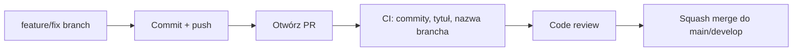

# Współpraca przy projekcie KaucjoMapa

Ten dokument opisuje konwencje pracy z repozytorium: branchy, commity, pull requesty oraz lokalne narzędzia (Husky, commitlint).

## Wymagania lokalne

- Node.js 20+ (zalecane: `nvm use` — wersja w pliku `.nvmrc`)
- npm 10+

Po sklonowaniu repozytorium:

```bash
npm install
```

Komenda `npm install` uruchamia `husky` (hook `prepare`) i konfiguruje lokalne hooki gita.

## Strategia branchy

| Branch | Cel |
| ------ | --- |
| `main` | Stabilna wersja, gotowa do wdrożenia |
| `develop` | Integracja zmian przed merge do `main` (opcjonalnie na etapie MVP) |
| `feature/*` | Nowe funkcjonalności |
| `fix/*` | Poprawki błędów |
| `chore/*` | Konfiguracja, narzędzia, porządki |
| `docs/*` | Wyłącznie dokumentacja |
| `refactor/*` | Refaktoryzacja bez zmiany zachowania |
| `test/*` | Testy |
| `ci/*` | Zmiany w pipeline CI/CD |
| `build/*` | Build, zależności, bundler |
| `hotfix/*` | Pilne poprawki produkcyjne |
| `cursor/*-f7a4` | Branche agentów Cursor (automatyzacja) |

### Przykłady poprawnych nazw

```
feature/map-markers
fix/geolocation-permission
chore/repo-tooling-setup
docs/contributing-guide
cursor/map-mvp-f7a4
```

### Zasady nazewnictwa

- małe litery,
- słowa rozdzielone myślnikiem `-`,
- krótki, opisowy fragment po prefiksie (`feature/nazwa-zmiany`),
- bez spacji, polskich znaków diakrytycznych ani podkreślników.

## Konwencja commitów (Conventional Commits)

Format:

```
<type>(<scope>): <krótki opis w trybie rozkazującym>

[opcjonalny dłuższy opis]

[opcjonalna stopka, np. Closes #12]
```

### Dozwolone typy

| Typ | Kiedy używać |
| --- | ------------ |
| `feat` | Nowa funkcjonalność |
| `fix` | Poprawka błędu |
| `docs` | Tylko dokumentacja |
| `style` | Formatowanie, bez zmiany logiki |
| `refactor` | Refaktoryzacja |
| `perf` | Optymalizacja wydajności |
| `test` | Testy |
| `build` | Build, zależności |
| `ci` | GitHub Actions, pipeline |
| `chore` | Inne zmiany pomocnicze |
| `revert` | Cofnięcie wcześniejszego commita |

### Przykłady

```
feat(map): dodaj markery punktów zwrotu
fix(status): popraw walidację formularza statusu
docs(readme): uzupełnij roadmapę MVP
chore(deps): zaktualizuj zależności deweloperskie
ci(workflows): dodaj sprawdzanie nazw branchy
```

### Zasady

- Tytuł commita: max 100 znaków.
- Opis w języku polskim lub angielskim — wybierz jeden język w danym PR i trzymaj się go konsekwentnie.
- `scope` jest opcjonalny, ale zalecany (np. `map`, `api`, `auth`).
- Jeden commit = jedna logiczna zmiana, jeśli to możliwe.

Walidacja odbywa się lokalnie (Husky) oraz w CI na PR-ach.

## Pull requesty

### Tytuł PR

Tytuł PR **musi** być zgodny z Conventional Commits — ten sam format co commit, np.:

```
feat(map): dodaj listę najbliższych punktów
```

CI odrzuci PR z niepoprawnym tytułem.

### Opis PR

Użyj szablonu z `.github/pull_request_template.md`. Uzupełnij:

- co zmieniasz i dlaczego,
- typ zmiany,
- powiązane issue (`Closes #123`),
- checklistę przed merge.

### Zasady merge

- PR do `main` lub `develop` wymaga przejścia workflow CI.
- Preferowany merge: **Squash and merge** (czytelna historia na `main`).
- Każdy PR powinien mieć przynajmniej jedną recenzję (po włączeniu branch protection w GitHub).

### Rekomendowany przepływ



## Husky (lokalne hooki)

| Hook | Działanie |
| ---- | --------- |
| `commit-msg` | Walidacja formatu commita (`commitlint`) |
| `pre-commit` | Przygotowany pod przyszłe lint/testy |

Jeśli hook blokuje commit, popraw wiadomość według komunikatu błędu.

Tymczasowe pominięcie (tylko w wyjątkowych sytuacjach):

```bash
git commit --no-verify -m "chore: opis"
```

Nie używaj `--no-verify` na stałe — omija zabezpieczenia jakości.

## GitHub Actions

Workflowy w `.github/workflows/`:

| Workflow | Kiedy działa | Co sprawdza |
| -------- | ------------ | ----------- |
| `ci.yml` | push/PR do `main`, `develop` | commity w PR, tytuł PR, konfiguracja repo |
| `branch-name.yml` | PR | zgodność nazwy brancha z konwencją |

Dependabot (`dependabot.yml`) co tydzień proponuje aktualizacje npm i GitHub Actions.

## Konfiguracja w GitHub (ręcznie)

Te ustawienia nie są w plikach repo — skonfiguruj je w GitHub → Settings:

### Branch protection dla `main`

- Require a pull request before merging
- Require status checks to pass: `Sprawdzenie commitów`, `Sprawdzenie tytułu PR`, `Sprawdzenie nazwy brancha`, `Stan repozytorium`
- Require branches to be up to date before merging
- Do not allow bypassing the above settings (opcjonalnie)

### Opcjonalnie dla `develop`

Te same reguły co dla `main`, jeśli używasz brancha integracyjnego.

### General

- Default branch: `main`
- Allow squash merge; wyłącz merge commit, jeśli nie są potrzebne
- Automatically delete head branches po merge PR

## Dodawanie lintów i testów (kolejny krok)

Gdy pojawi się kod aplikacji, rozszerz `pre-commit` o np. `lint-staged`:

```json
{
  "lint-staged": {
    "*.{js,ts,tsx}": ["eslint --fix", "prettier --write"]
  }
}
```

Workflow CI można wtedy rozszerzyć o `npm test` i `npm run lint`.
